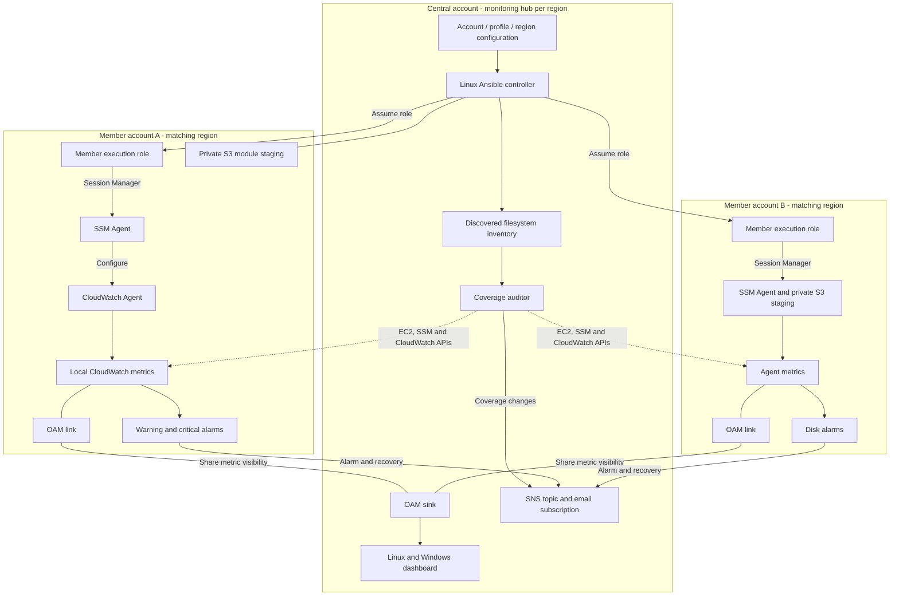

# Disk monitoring across AWS accounts

Ansible deploys the CloudWatch Agent and creates disk alarms on EC2 instances. It connects through AWS Systems Manager (SSM), so VMs do not need inbound SSH or WinRM ports. Agents keep sending filesystem metrics when the Ansible controller is unavailable.

CloudWatch cross-account observability (OAM) makes member-account metrics visible in a central account. Each monitored region has its own sink, SNS topic and dashboard. Metrics stay in their source accounts.

The supported scope is Amazon Linux, RHEL, Ubuntu and Debian on x86_64/ARM64, and 64-bit Windows Server. Actual Linux mounts and Windows fixed logical drives are discovered instead of assuming every VM has `/data` or `D:`. Inode, memory and application monitoring are outside this implementation.

## Architecture



Repeat this arrangement in each configured region. OAM provides metric visibility; it is not an ingestion endpoint and does not move metrics between regions.

## Files and execution flow

| File or directory | Purpose |
|---|---|
| [docs/key-components.md](docs/key-components.md) | Summary of access management, discovery, enrollment and monitoring components |
| [docs/project-walkthrough.md](docs/project-walkthrough.md) | Detailed explanation of every project file, setting and execution flow |
| [docs/architecture-overview.drawio](docs/architecture-overview.drawio) | Editable high-level architecture diagram |
| [docs/architecture-detailed.drawio](docs/architecture-detailed.drawio) | Editable diagram with all components and connections from the detailed architecture |
| `targets.yml` | Member accounts, assumed-role profiles, regions and central topics |
| `cloudformation/01_central_monitoring_sink.yml` | Regional central sink, SNS topic and dashboard |
| `cloudformation/02_member_account_baseline.yml` | Account-wide execution role and optional VM profile |
| `cloudformation/03_member_region.yml` | Regional OAM link and private staging bucket |
| `cloudformation/controller_policy.example.json` | Example permissions for the existing controller role |
| `ansible/inventory/aws_ec2.yml` | Dynamic EC2 inventory; the runner supplies its profile and region |
| `ansible/inventory/group_vars/all.yml` | Shared thresholds, metric names, exclusions and audit timing |
| `ansible/playbook_deploy_monitoring.yml` | Linux and Windows plays using the same role |
| `ansible/roles/cloudwatch_disk_agent/` | Discovery, verified installation, configuration and alarms |
| `scripts/run_monitoring.py` | Sequential target runner, locking and coverage notifications |
| `scripts/coverage_reconciler.py` | Per-filesystem checks using AWS APIs |
| `tests/` | Offline failure-case tests and a controlled disk-pressure test |

Deployment selects a target, verifies its account identity, discovers running VMs and disks, saves disk expectations, configures the agent and creates alarms. Auditing compares those independent expectations with recent metrics and correctly configured alarms. A disk that never emitted metrics cannot disappear from the expected set.

## Metrics and alerts

| Platform | Metric in `CWAgent` | Exact dimensions | Warning | Critical |
|---|---|---|---|---|
| Linux | `disk_used_percent` | `InstanceId`, `path` | Used >= 80% | Used >= 90% |
| Windows | `disk_free_percent` | `InstanceId`, `instance`, `objectname=LogicalDisk` | Free <= 20% | Free <= 10% |

Custom metrics require matching dimensions. Linux publishes a per-mount aggregation and suppresses its original device/type variants. Windows retains its native three dimensions and renames `% Free Space` to `disk_free_percent`.

Collection runs every 60 seconds. Capacity alarms use three consecutive one-minute datapoints and send alarm/recovery messages to the regional central SNS topic. Both severities use the same email channel, with severity in the name and description. PagerDuty, Slack and ticket creation are not configured.

Capacity alarms use `TreatMissingData: missing`. The auditor detects absent telemetry on running VMs separately, so intentionally stopping a VM does not imply a full disk. It also flags an offline SSM Agent because configuration can no longer be maintained reliably.

Defaults: metrics fresh for five minutes; filesystem discovery fresh for 30 minutes; first enrollment/recently started VMs have a bounded 15-minute grace period. `PENDING` is not verified coverage. Repeated deployments do not reset first-enrollment grace.

The agent collects disk resources using `*`. Linux pseudo/temporary filesystems use a shared exclusion list. Windows alarms cover discovered fixed logical drives, not `_Total`. A new disk can emit before the next deployment, but receives alarms after that run discovers it.

## Prerequisites

Use a Linux controller with Python 3.11 or newer, preferably an EC2 instance in the central account with an existing IAM role. That role needs the adapted `controller_policy.example.json` permissions. Provisioning administrator permissions are separate from runtime monitoring permissions.

Install the AWS CLI, [Session Manager plugin](https://docs.aws.amazon.com/systems-manager/latest/userguide/session-manager-working-with-install-plugin.html), and project dependencies:

```bash
python3 -m venv .venv
source .venv/bin/activate
python -m pip install -r requirements-dev.txt
ansible-galaxy collection install -r ansible/requirements.yml
```

Each VM needs a running SSM Agent with `Online` status, `AmazonSSMManagedInstanceCore` and `CloudWatchAgentServerPolicy` permissions, and access to EC2 metadata for its identity/credentials. Provide outbound HTTPS connectivity to SSM, `ssmmessages`, CloudWatch metrics, S3 and package sources. Older SSM configurations may also require `ec2messages`. Linux requires `curl` for module transfers and repositories for `gnupg`/`gnupg2`. Windows requires PowerShell, working performance counters and certificate trust/validation connectivity.

Linux VMs also need Python 3.8 or newer for the pinned Ansible version. Include it in the image/bootstrap process, particularly on older distributions.

Private endpoints can provide AWS connectivity; package repositories still need egress or an approved mirror. Private subnets alone do not provide these connections.

Attach the baseline's instance profile only to VMs without an existing application role. Add monitoring permissions to an existing role instead of replacing it. Include SSM/permissions in new images or launch templates. Ansible cannot bootstrap its SSM connection when these prerequisites are absent; the auditor reports the resulting gap.

## Deployment

Replace all example IDs, profiles, role ARNs and emails. Use administrator profiles for infrastructure provisioning and member execution profiles for runtime jobs. Run commands from the repository root.

### 1. Central hub: each monitored region

The controller role must already exist. For the example targets, deploy in both `us-east-1` and `us-west-2`:

```bash
aws cloudformation deploy \
  --profile central-admin --region us-east-1 \
  --template-file cloudformation/01_central_monitoring_sink.yml \
  --stack-name Central-Disk-Monitoring \
  --parameter-overrides \
    OrganizationId=o-exampleorg123 \
    AcquiredAccountIds=111122223333,444455556666 \
    NotificationEmail=alerts@example.com \
    CentralControllerRoleArn=arn:aws:iam::123456789012:role/DiskMonitoringController

aws cloudformation describe-stacks \
  --profile central-admin --region us-east-1 \
  --stack-name Central-Disk-Monitoring --query 'Stacks[0].Outputs'
```

Record each region's `CentralSinkArn` and `CentralAlertTopicArn`. Omit `AcquiredAccountIds` if all accounts belong to the Organization. Confirm the SNS email subscription in each region.

### 2. Member IAM: once per account

Use one chosen provisioning region for account-wide IAM resources:

```bash
aws cloudformation deploy \
  --profile member-a-admin --region us-east-1 \
  --template-file cloudformation/02_member_account_baseline.yml \
  --stack-name Member-Disk-Monitoring-IAM \
  --parameter-overrides \
    CentralControllerRoleArn=arn:aws:iam::123456789012:role/DiskMonitoringController \
  --capabilities CAPABILITY_NAMED_IAM
```

Repeat for member B. Attach VM permissions as described in prerequisites. The execution role trusts the exact controller role, not the whole central account.

### 3. Member regional resources: every target pair

Use the central sink ARN from the same region:

```bash
aws cloudformation deploy \
  --profile member-a-admin --region us-east-1 \
  --template-file cloudformation/03_member_region.yml \
  --stack-name Member-Disk-Monitoring-Region \
  --parameter-overrides CentralSinkArn='<central-us-east-1-sink-arn>'
```

Staging buckets are named `ansible-ssm-staging-<account-id>-<region>`, encrypted, private, TLS-only, and expire abandoned transfers after one day. Versioning is not enabled. Transfers use controller-signed URLs; VM roles need no staging-bucket permission.

### 4. Controller policy and role-based profiles

Adapt the controller policy's account/topic ARNs, then attach it using administrator credentials:

```bash
aws iam put-role-policy \
  --profile central-admin --role-name DiskMonitoringController \
  --policy-name DiskMonitoringRuntime \
  --policy-document file://cloudformation/controller_policy.example.json
```

On the EC2 controller, add profiles to `~/.aws/config`:

```ini
[profile workload-a]
role_arn = arn:aws:iam::111122223333:role/AnsibleCrossAccountExecutionRole
credential_source = Ec2InstanceMetadata
region = us-east-1

[profile workload-b]
role_arn = arn:aws:iam::444455556666:role/AnsibleCrossAccountExecutionRole
credential_source = Ec2InstanceMetadata
region = us-west-2
```

These profiles use temporary member-role credentials from the controller's EC2 role; they contain no access keys. Verify with `aws sts get-caller-identity --profile workload-a`.

Edit `targets.yml` to match the deployed resources. `controller_profile: null` uses the controller's normal credentials for coverage notifications; a named central profile can be supplied instead. The runner verifies member identity and the central publisher account.

### 5. Deploy and audit

```bash
# Display configured targets without making AWS requests.
python scripts/run_monitoring.py list

# Pilot one target, then deploy every configured target.
python scripts/run_monitoring.py deploy --target workload-a-us-east-1
python scripts/run_monitoring.py deploy

# Verify every expected filesystem and both alarms.
python scripts/run_monitoring.py audit

# Notify on changed coverage results and recovery.
python scripts/run_monitoring.py audit --notify
```

The runner selects `ansible/ansible.cfg` explicitly and creates a temporary inventory per account/region. Ansible uses batches of 25 hosts. Delegated CloudWatch calls use the same target profile/region and local connection settings.

Generated state lives in `.monitoring-state/<target-name>/`: per-instance disk expectations, deployment status and the last notified result. Keep it on the controller; it is excluded from Git. Missing, stale or malformed state fails the audit. A shared lock prevents concurrent deployments/audits; a skipped overlapping job exits nonzero and is visible in its job log.

An audit returns zero only for verified coverage. Gaps, errors and pending enrollment return nonzero. Notifications suppress unchanged results; failed notification delivery is retried on the next run.

Regular deployments preserve installed agent versions. Linux downloads are checked against AWS's detached signature and pinned key fingerprint; Windows packages require a valid Amazon Authenticode signature. Configuration changes restart the agent through handlers. Agent upgrades use a separate controlled maintenance process.

## Enrollment and scalability

Use the existing Ansible scheduler or controller cron. For a checkout at `/opt/disk-monitoring`, create a `logs` directory and use:

```cron
*/15 * * * * cd /opt/disk-monitoring && .venv/bin/python scripts/run_monitoring.py deploy >> logs/deploy.log 2>&1
*/5 * * * * cd /opt/disk-monitoring && .venv/bin/python scripts/run_monitoring.py audit --notify >> logs/audit.log 2>&1
```

Jobs must use the same controller user, AWS configuration and state directory. Synchronize time and rotate logs. These are scheduler examples; no schedules are installed by this repository.

A new bootstrapped VM or filesystem receives configuration/alarms on the next successful deployment, normally within 15 minutes plus run time. Missing telemetry is detected after the five-minute freshness window and next audit, normally within roughly ten minutes.

The 30-minute discovery expiry assumes deployments finish within that interval. For large fleets, measure run duration and set expiry longer than deployment interval plus maximum run time. If jobs outgrow their schedule, adjust intervals or distribute targets across scheduled controller jobs with independent state directories. Monitor failed jobs and keep API concurrency bounded.

New account onboarding:

1. Deploy its IAM baseline once and its regional resources in each monitored region.
2. Add external acquired accounts to central allowlists where required.
3. Bootstrap VM SSM/permissions and verify connectivity.
4. Add its role profile, target entries and controller assume-role permissions.
5. Run deployment and auditing for the new target.

For Organization accounts, use a service-managed CloudFormation StackSet from the IAM baseline, targeting workload organizational units in one provisioning region with automatic deployment enabled. Use a second regional StackSet per monitored region, supplying its matching sink ARN. Standalone accounts use direct deployment or self-managed StackSets.

StackSets distribute baselines; VM bootstrap and controller profiles/target configuration remain explicit onboarding steps. Baseline deployment alone does not fully enroll a new account in monitoring.

## Verification

After installing dependencies:

```bash
python -m unittest discover -s tests -p 'test_*.py' -v
cfn-lint cloudformation/01_central_monitoring_sink.yml \
  cloudformation/02_member_account_baseline.yml cloudformation/03_member_region.yml
ANSIBLE_CONFIG=ansible/ansible.cfg ansible-playbook \
  -i 'localhost,' ansible/playbook_deploy_monitoring.yml --syntax-check
bash -n tests/simulate_disk_pressure.sh
```

The static syntax check makes no AWS requests. Offline tests cover pagination/batching, stale inventory, missing disks, invalid alarms, account isolation, deployment failure and notification retries. These checks do not prove actual SSM access, Windows execution or live alarm delivery.

Pilot Linux and Windows across two accounts/two regions. Confirm metric dimensions, alarms, central dashboard visibility and SNS delivery. Repeat deployment to check that unchanged configuration does not reinstall/restart agents.

On a disposable Linux instance, provide a separately mounted ext4/xfs test filesystem of about 512 MiB–1 GiB, on a different device from root. It must already appear in the audit:

```bash
sudo bash tests/simulate_disk_pressure.sh /mnt/disk-monitor-test 85
sudo bash tests/simulate_disk_pressure.sh /mnt/disk-monitor-test 95
```

The script calculates allocation, caps filesystem/allocation size at 1 GiB, retains 16 MiB free, and cleans its unique file on exit, interruption or allocation failure. It refuses root/common system paths. Ext4 reserved blocks may prevent reaching 95% safely; use an appropriate disposable layout without changing production reserves. Verify metric, alarm and SNS delivery before pressing Enter, then verify recovery. Allow up to ten minutes for observation.

Also stop/restart the CloudWatch Agent on a running test VM and verify missing-telemetry/recovery results. Stop the EC2 instance intentionally and verify it is excluded. Attach/mount a new test disk and verify two alarms after deployment. Disable one alarm's actions and verify an audit gap, then redeploy to restore its actions. Capture actual pilot results separately; no illustrative output is presented here as evidence of a live deployment.

## Operations and limitations

- Auditing trusts independently discovered disks. A newly attached disk cannot become expected until discovery succeeds; stale discovery fails visibly.
- Capacity monitoring survives controller outages. Enrollment and coverage notifications require the controller, whose jobs should be monitored through the existing operations process.
- Windows coverage is fixed drives exposed by `Win32_LogicalDisk`. Directory-only volume mount points and clustered layouts need an explicit extension. Unsupported platforms fail deployment.
- CloudWatch dashboard searches have series limits. Use regional/account-filtered views for large fleets; per-filesystem alarms and audits establish alert coverage.
- The auditor lists obsolete alarm candidates only for running hosts with fresh discovery. Review and remove confirmed obsolete alarms using administrator credentials. Retired instances need a manual alarm review; runtime roles never delete alarms automatically.
- Keep default metric names/namespace unless OAM filters and dashboard searches are updated together. Threshold changes also require matching dashboard annotations.
- Full-disk remediation, package upgrades and bootstrap are explicit operations. This solution does not delete workload data or resize disks.

## Cost model

Count filesystems rather than VMs. One published capacity metric and two alarms per eligible filesystem means 1,000 VMs averaging two filesystems produce approximately 2,000 metrics and 4,000 alarms. Windows wildcard counters can add `_Total` or other series; measure actual publication during the pilot.

Estimate monthly cost using regional metric/alarm prices plus dashboards, SNS, S3, controller and network/endpoint costs. Check [CloudWatch pricing](https://aws.amazon.com/cloudwatch/pricing/) and [Systems Manager pricing](https://aws.amazon.com/systems-manager/pricing/). OAM metric sharing has no additional sharing fee. No fixed per-VM cost or third-party savings percentage is claimed.

## Repository hygiene

Exclude local controller state (`.monitoring-state`), virtual environments, and downloaded temporary installers using `.gitignore`. Ensure credentials, sensitive account IDs, or private bucket names are reviewed prior to committing or publishing updates.

## References

- [Ansible EC2 inventory](https://docs.ansible.com/ansible/latest/collections/amazon/aws/aws_ec2_inventory.html)
- [Ansible SSM connection](https://docs.ansible.com/ansible/latest/collections/amazon/aws/aws_ssm_connection.html)
- [CloudWatch Agent configuration](https://docs.aws.amazon.com/AmazonCloudWatch/latest/monitoring/CloudWatch-Agent-Configuration-File-Details.html)
- [Agent signature verification](https://docs.aws.amazon.com/AmazonCloudWatch/latest/monitoring/verify-CloudWatch-Agent-Package-Signature.html)
- [Custom metric dimensions](https://docs.aws.amazon.com/AmazonCloudWatch/latest/monitoring/cloudwatch_concepts.html)
- [Cross-account regional scope](https://docs.aws.amazon.com/AmazonCloudWatch/latest/monitoring/CloudWatch-Cross-Account-Methods.html)
- [Alarm notification policies](https://docs.aws.amazon.com/AmazonCloudWatch/latest/monitoring/Notify_Users_Alarm_Changes.html)
- [StackSets automatic deployment](https://docs.aws.amazon.com/AWSCloudFormation/latest/UserGuide/stacksets-orgs-manage-auto-deployment.html)
